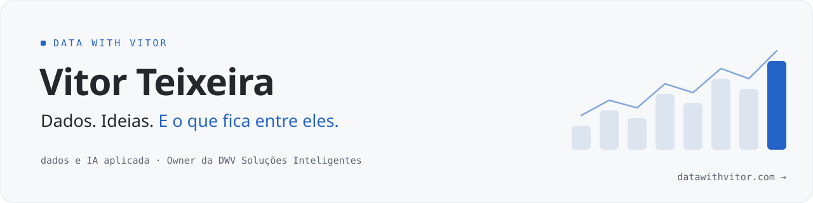

<a href="https://www.datawithvitor.com/?utm_source=github&utm_medium=referral&utm_campaign=perfil-github&utm_content=banner">
  <picture>
    <source media="(prefers-color-scheme: dark)" srcset="assets/banner-dark.svg">
    
  </picture>
</a>

  
  
  
  
  

## Prazer, Vitor.

Sou owner da **[DWV Soluções Inteligentes](https://www.dwvsolution.com/?utm_source=github&utm_medium=referral&utm_campaign=perfil-github&utm_content=bio)**. Trabalho com dados e IA aplicada: automatizo processos, levo LLMs para dashboards e sistemas e transformo dados brutos em decisões claras.

No **[Data with Vitor](https://www.datawithvitor.com/sobre.html?utm_source=github&utm_medium=referral&utm_campaign=perfil-github&utm_content=bio)** eu escrevo sobre a relevância dos dados, os efeitos dos vieses cognitivos e a arte de apresentar e visualizar informação.

<table>
  <tr>
    <td width="33%" valign="top">
      <b>📊 BI e Analytics</b> 
      Modelagem, ETL e painéis em Qlik Sense, do script de carga à governança do ambiente.
    </td>
    <td width="33%" valign="top">
      <b>🤖 IA aplicada</b> 
      LLMs, agentes e servidores MCP conectando modelos de IA aos dados da empresa.
    </td>
    <td width="33%" valign="top">
      <b>⚙️ Automação</b> 
      Pipelines em Python que tiram o trabalho repetitivo das pessoas e entregam o dado pronto.
    </td>
  </tr>
</table>

## ✍️ Últimos textos do blog

<!-- BLOG-POST-LIST:START -->
<!-- BLOG-POST-LIST:END -->

➡️ [Ver todos os textos](https://www.datawithvitor.com/textos.html?utm_source=github&utm_medium=referral&utm_campaign=perfil-github&utm_content=todos-os-textos)

## 🧰 Ferramentas do dia a dia

  
  
  
  
  
  
  
  

## 📂 Projetos abertos

| Projeto | O que é |
|---|---|
| [**MCP_QlikInternalServer**](https://github.com/vitaotex2708/MCP_QlikInternalServer) | Servidor MCP que dá a agentes de IA leitura do ambiente Qlik on-premise: scripts e QVDs do ETL, QIX Engine e observabilidade via QRS. |
| [**FarmaScripts**](https://github.com/vitaotex2708/FarmaScripts) | Scripts Qlik Sense para tratar dados de auditorias da indústria farmacêutica (calendário farma, extração PMB). |
| [**Howbootcamp**](https://github.com/vitaotex2708/Howbootcamp) | Exercícios de engenharia de dados: ingestão, SQL, APIs, crawlers e testes. |

## 💬 Vamos conversar

Quer dados e IA trabalhando a favor do seu negócio? **[Conheça a DWV](https://www.dwvsolution.com/?utm_source=github&utm_medium=referral&utm_campaign=perfil-github&utm_content=cta-final)** ou escreva para **[services@datawithvitor.com](mailto:services@datawithvitor.com)**.
